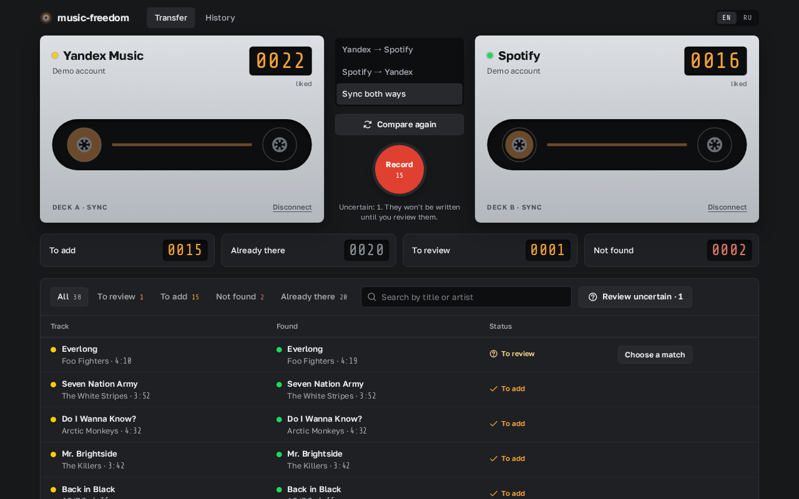
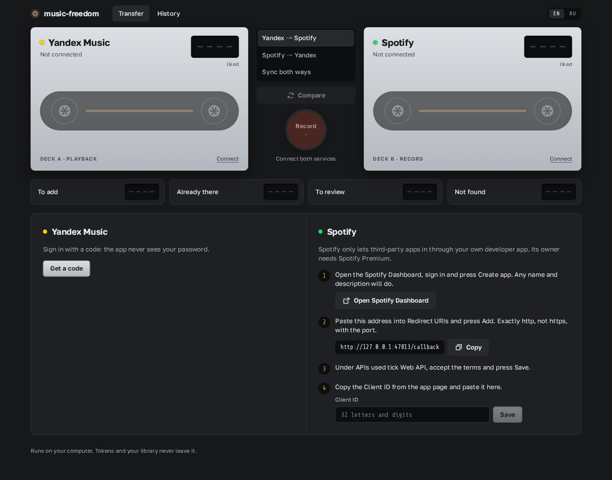
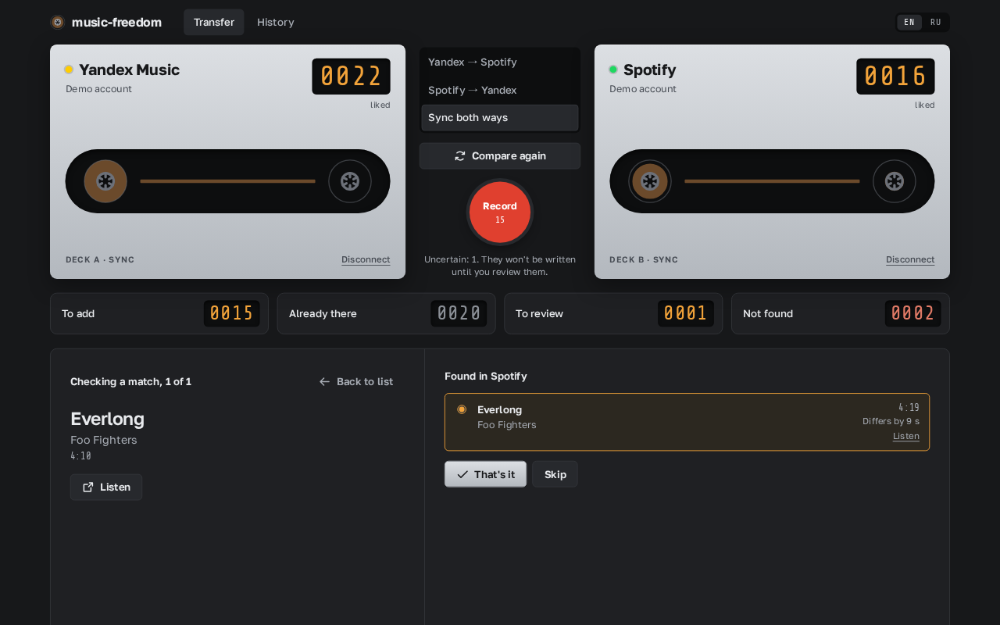
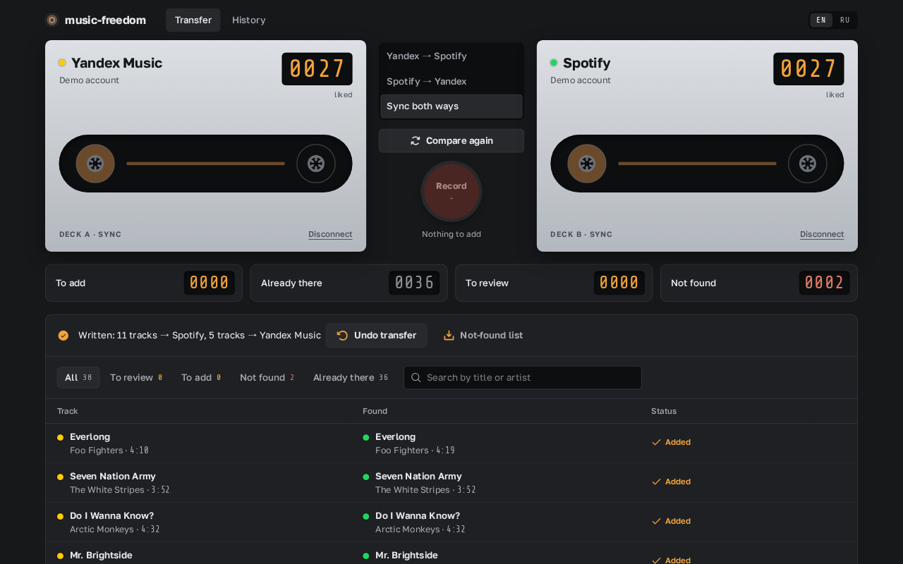
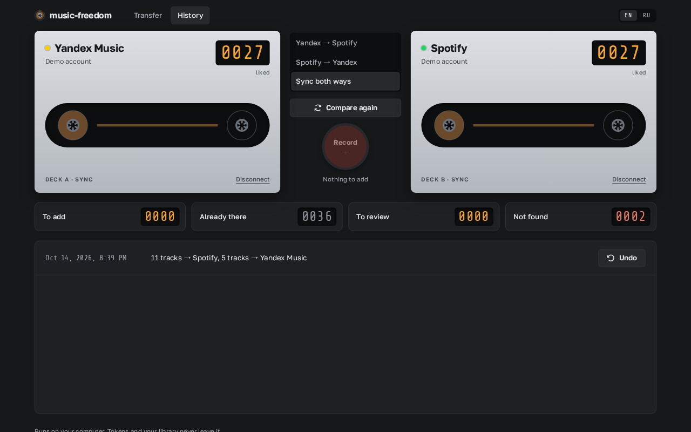
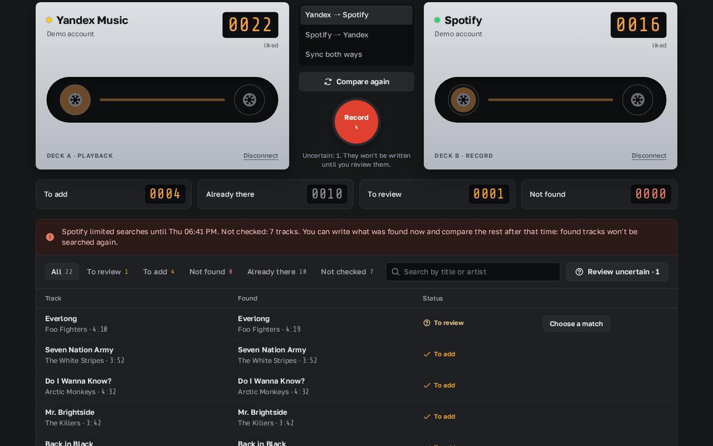

# music-freedom

**English** · [Русский](README.ru.md)

Sync your liked tracks between **Yandex Music** and **Spotify**. A small free app that runs on your computer and opens in your browser: no accounts on third-party servers, no subscriptions, your tokens and library never leave your machine.



## What it does

- **Transfer in any direction or sync both ways.** Yandex → Spotify, Spotify → Yandex, or both at once, so that the two services end up with the same liked tracks.
- **No duplicates.** Tracks that are already liked in the target service are skipped.
- **Preview before writing.** You see how many tracks will be added, which are already there, which need your decision and which were not found. Nothing is written until you press Record.
- **Uncertain matches are yours to decide.** When a track only looks similar (another duration, a live version), you compare the options side by side and pick one or skip it.
- **Undo.** Every transfer can be undone: the app removes exactly the tracks it added and never touches the ones you liked yourself.
- **Never deletes your likes.** Removals are not synced: if you unlike a track in one service, the app doesn't remove it from the other.
- **Resumes where it stopped.** Every found match is saved, so a repeated comparison only looks up new tracks. This matters with Spotify's strict limits (see below).
- **English and Russian interface.**

Only liked tracks are synced for now. Playlists and albums are planned.

## Download and run

1. Download the archive for your system from the [latest release](https://github.com/tomastaker/music-freedom/releases/latest):
   - Windows: `music-freedom-windows-x64.zip`
   - macOS with Apple Silicon (M1–M4): `music-freedom-macos-apple-silicon.zip`
   - macOS with Intel: `music-freedom-macos-intel.zip`
   - Linux: `music-freedom-linux-x64.zip`
2. Unpack it and start the `music-freedom` file. A browser tab with the app opens, together with a console window. **Keep the console window open while you use the app**: closing it stops the app.

The app is not signed, so the system warns about an unknown developer on the first start:

- **Windows:** in the “Windows protected your PC” dialog press **More info**, then **Run anyway**.
- **macOS:** open **System Settings → Privacy & Security**, press **Open Anyway** at the bottom, then start the file again.
- **Linux:** if the file doesn't start, make it executable: `chmod +x music-freedom-linux-x64`.

Starting the file again while the app is running just opens its tab.

## Connect the services

On the first start the app shows how to connect both services.



### Yandex Music

Press **Get a code**, open [ya.ru/device](https://ya.ru/device) and enter the code shown in the app. The app never sees your password.

### Spotify

Spotify only lets third-party apps in through **your own developer app**, and **its owner needs Spotify Premium**. It takes about five minutes, once:

1. Open the [Spotify Developer Dashboard](https://developer.spotify.com/dashboard), sign in and press **Create app**. Any name and description will do.
2. In **Redirect URIs** add exactly `http://127.0.0.1:47813/callback` and press **Add**. It must be `http`, not `https`, and include the port; the app has a Copy button for it.
3. Under **APIs used** tick **Web API**, accept the terms and press **Save**.
4. Copy the **Client ID** from the app page, paste it into music-freedom, press **Save**, then **Sign in with Spotify**.

## Transfer or sync

1. Choose the direction: **Yandex → Spotify**, **Spotify → Yandex** or **Sync both ways**.
2. Press **Compare**. The first comparison takes a few minutes: every track is looked up in the other service's catalog. The decks' reels spin while the app works.
3. Look through the result. The four indicators and the filter tabs show what will be added, what is already there, what needs review and what wasn't found.
4. Press **Review uncertain** to go through doubtful matches one by one. Each has a **Listen** link to check it in the service.

   

5. Press the red **Record** button. Tracks are written oldest first, in batches.
6. When it's done you get a report with an **Undo transfer** button and a downloadable list of tracks that weren't found.

   

All transfers are listed on the **History** tab, and each one can be undone there.



## Spotify limits and large libraries

A Spotify developer app gets a small request quota. After roughly a thousand and a half searches Spotify can block **searching** for almost a day (reading and saving likes keep working). The app handles this:

- the comparison finishes partially: everything found so far can be written right away;
- the tracks that weren't checked are marked and the app tells you when the limit ends;
- after that time press **Compare** again: found tracks aren't searched again, only the unchecked ones are;
- tracks that were already written count as “already there” without any searching.



So a library of a few thousand tracks may take two sessions on different days, but no work is ever repeated.

## Notes for users in Russia

Spotify is not available in Russia, so you need a VPN to use it. Yandex Music works over a VPN too: the app talks to Yandex over IPv4, where most VPNs don't break the connection. If a service is unreachable, its deck shows a message and a **Retry** button.

## How tracks are matched

First by ISRC when both services provide it (Yandex usually doesn't), then by artist and title, ignoring differences in how services spell versions (“Remastered”, “feat.”, “(Radio Edit)” vs “- Radio Edit”), transliteration (Кино = Kino) and checking the duration. Live, acoustic and remix versions are treated as different recordings. Confident matches are added automatically, doubtful ones wait for you, and tracks that aren't in the other catalog are listed honestly.

## Privacy and data

Everything stays on your computer, in `~/.music-freedom/` (on Windows `C:\Users\<you>\.music-freedom\`):

- `tokens.json`: sign-ins to the services, readable only by your user;
- `data.sqlite`: found matches and the transfer history used by undo.

The app's local web server only accepts requests from its own page, so other websites open in your browser can't control it. Delete the folder to remove all app data.

## Troubleshooting

- **Spotify says `redirect_uri: Not matching configuration`.** The Redirect URI in the Spotify Dashboard must be exactly `http://127.0.0.1:47813/callback`: `http`, not `https`, `127.0.0.1`, not `localhost`, with the port.
- **“Spotify denied access”.** The owner of the developer app needs Spotify Premium.
- **“… is unavailable in your country”.** Turn a VPN on (for Spotify from Russia) or try another VPN server, then press **Retry** on the deck.
- **“Port 47813 is used by another program”.** Another program occupies the port the app needs for the Spotify sign-in. Close it and start music-freedom again.

## Development

You need [Bun](https://bun.sh).

```sh
bun install
bun run dev            # server with reload at http://127.0.0.1:47813
MF_DEMO=1 bun run dev  # demo: made-up libraries, real accounts are never touched
MF_DEMO=1 MF_DEMO_LIMIT=1 bun run dev  # demo that imitates the Spotify search limit
bun test
bun run lint
bun run typecheck
bun run build          # single-file executables and zips for Windows, macOS and Linux in dist/app/
```

All platforms are built from one machine. Interface strings live in `src/web/i18n/` (`en.ts`, `ru.ts`). A new service implements the `MusicService` interface from `src/core/service.ts`.

The Yandex Music API is unofficial and may change without notice; if something breaks, please open an issue.

## License

[MIT](LICENSE). Bundled third-party components are listed in [THIRD_PARTY_NOTICES.md](THIRD_PARTY_NOTICES.md).
