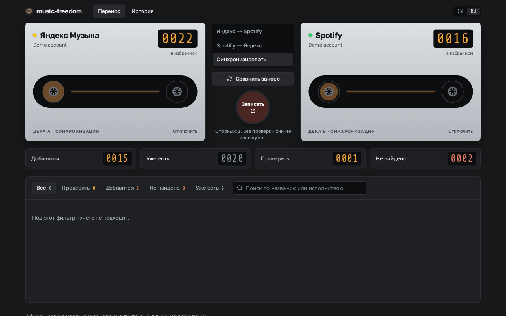
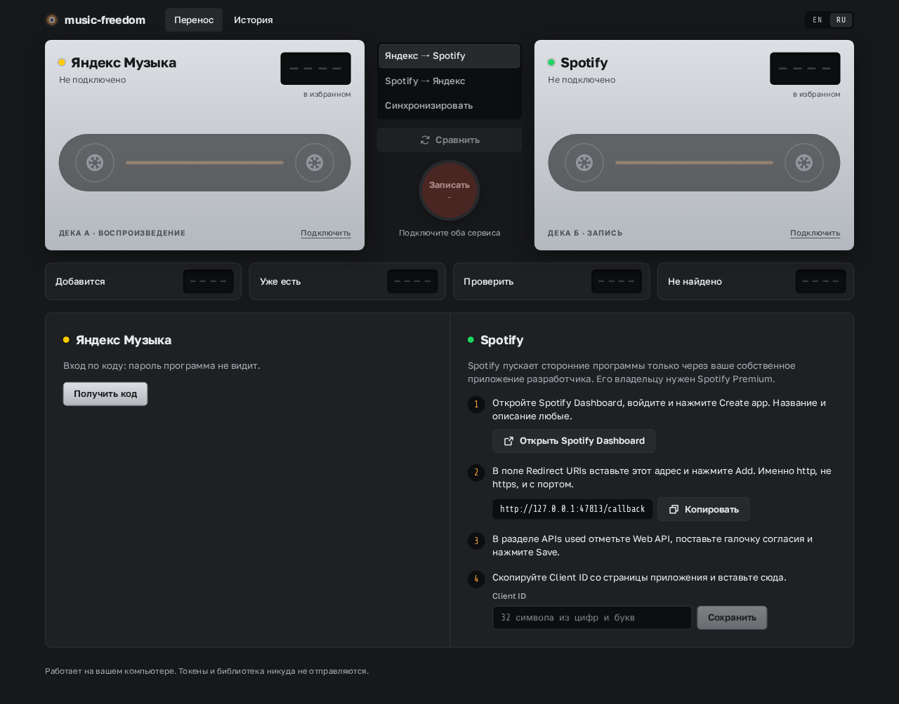
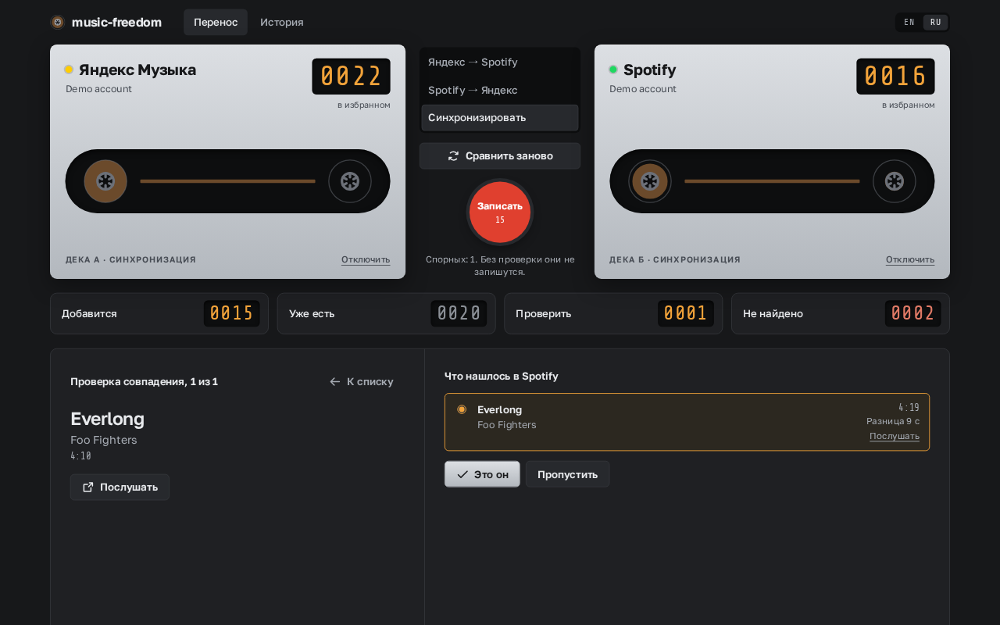
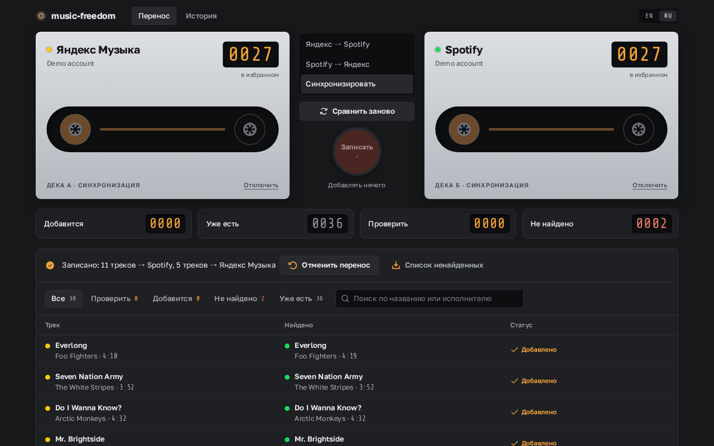
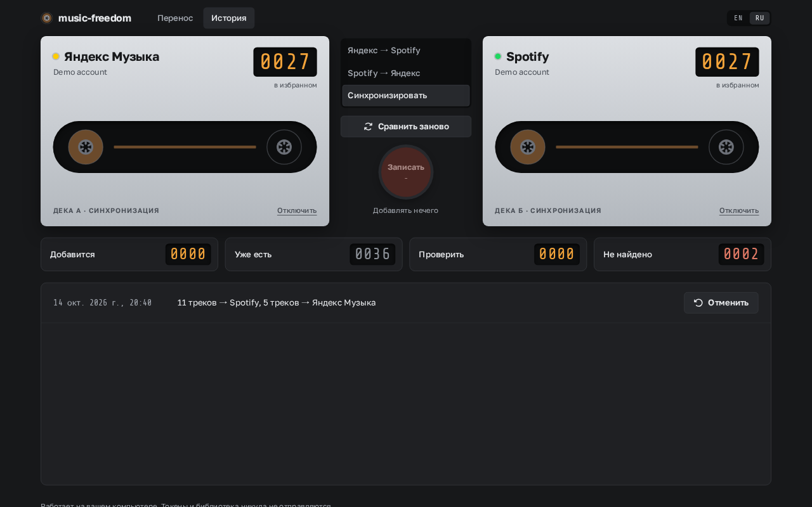
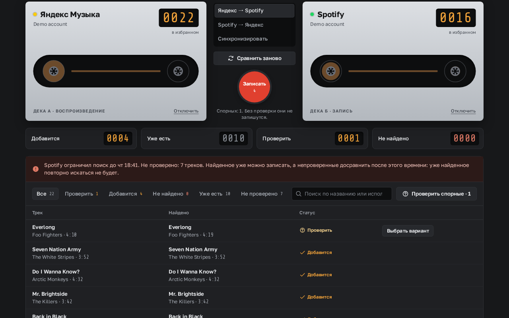

# music-freedom

[English](README.md) · **Русский**

Синхронизирует избранные треки между **Яндекс Музыкой** и **Spotify**. Небольшая бесплатная программа: работает на вашем компьютере и открывается во вкладке браузера. Никаких аккаунтов на чужих серверах и подписок, токены и библиотека не покидают ваш компьютер.



## Что умеет

- **Перенос в любую сторону или синхронизация в обе.** Яндекс → Spotify, Spotify → Яндекс или сразу в обе стороны, чтобы в обоих сервисах было одинаковое избранное.
- **Без дублей.** Треки, которые уже есть в избранном целевого сервиса, пропускаются.
- **Предпросмотр перед записью.** Видно, сколько треков добавится, какие уже есть, какие требуют решения и какие не нашлись. Пока вы не нажали «Записать», ничего не меняется.
- **Спорные совпадения решаете вы.** Если трек только похож (другая длительность, концертная версия), варианты показываются рядом, и вы выбираете нужный или пропускаете.
- **Отмена.** Любой перенос можно отменить: программа уберёт ровно те треки, которые добавила сама, и не тронет лайки, поставленные вами.
- **Никогда не удаляет ваши лайки.** Удаления не синхронизируются: если убрать лайк в одном сервисе, в другом трек останется.
- **Продолжает с места остановки.** Каждое найденное совпадение сохраняется, поэтому повторное сравнение ищет только новые треки. Это важно при строгих лимитах Spotify (см. ниже).
- **Интерфейс на русском и английском.**

Пока синхронизируются только избранные треки. Плейлисты и альбомы в планах.

## Скачать и запустить

1. Скачайте архив для своей системы со страницы [последнего релиза](https://github.com/tomastaker/music-freedom/releases/latest):
   - Windows: `music-freedom-windows-x64.zip`
   - macOS на Apple Silicon (M1–M4): `music-freedom-macos-apple-silicon.zip`
   - macOS на Intel: `music-freedom-macos-intel.zip`
   - Linux: `music-freedom-linux-x64.zip`
2. Распакуйте и запустите файл `music-freedom`. Откроется вкладка браузера с программой и окно консоли. **Не закрывайте окно консоли, пока пользуетесь программой**: его закрытие выключает программу.

Программа не подписана, поэтому при первом запуске система предупредит о неизвестном разработчике:

- **Windows:** в окне «Windows защитила ваш компьютер» нажмите **Подробнее**, затем **Выполнить в любом случае**.
- **macOS:** откройте **Системные настройки → Конфиденциальность и безопасность**, внизу нажмите **Всё равно открыть** и запустите файл ещё раз.
- **Linux:** если файл не запускается, сделайте его исполняемым: `chmod +x music-freedom-linux-x64`.

Если программа уже запущена, повторный запуск просто открывает её вкладку.

## Подключение сервисов

При первом запуске программа показывает, как подключить оба сервиса.



### Яндекс Музыка

Нажмите **Получить код**, откройте [ya.ru/device](https://ya.ru/device) и введите код из программы. Пароль программа не видит.

### Spotify

Spotify пускает сторонние программы только через **ваше собственное приложение разработчика**, и **его владельцу нужен Spotify Premium**. Это делается один раз, минут за пять:

1. Откройте [Spotify Developer Dashboard](https://developer.spotify.com/dashboard), войдите и нажмите **Create app**. Название и описание любые.
2. В поле **Redirect URIs** добавьте ровно `http://127.0.0.1:47813/callback` и нажмите **Add**. Именно `http`, не `https`, и с портом; в программе для адреса есть кнопка «Копировать».
3. В разделе **APIs used** отметьте **Web API**, поставьте галочку согласия и нажмите **Save**.
4. Скопируйте **Client ID** со страницы приложения, вставьте в music-freedom, нажмите **Сохранить**, затем **Войти через Spotify**.

## Перенос и синхронизация

1. Выберите направление: **Яндекс → Spotify**, **Spotify → Яндекс** или **Синхронизировать**.
2. Нажмите **Сравнить**. Первое сравнение занимает несколько минут: каждый трек ищется в каталоге другого сервиса. Пока программа работает, на деках крутятся катушки.
3. Просмотрите результат. Четыре индикатора и вкладки-фильтры показывают, что добавится, что уже есть, что нужно проверить и что не нашлось.
4. Нажмите **Проверить спорные**, чтобы разобрать сомнительные совпадения по одному. У каждого есть ссылка **Послушать**.

   

5. Нажмите красную кнопку **Записать**. Треки записываются от старых к новым, пачками.
6. После записи появится отчёт с кнопкой **Отменить перенос** и списком ненайденных треков, который можно скачать.

   

Все переносы собраны на вкладке **История**, и каждый можно отменить там.



## Лимиты Spotify и большие библиотеки

У приложения разработчика Spotify маленькая квота запросов. Примерно после полутора тысяч поисков Spotify может закрыть **поиск** почти на сутки (чтение и запись лайков продолжают работать). Программа это переживает:

- сравнение завершается частично: всё найденное можно записать сразу;
- непроверенные треки помечены, и программа пишет, когда снимется ограничение;
- после этого времени нажмите **Сравнить** ещё раз: найденное заново не ищется, проверяются только оставшиеся треки;
- уже записанные треки считаются «уже есть» без всякого поиска.



Поэтому библиотека в несколько тысяч треков может занять два захода в разные дни, но работа никогда не повторяется.

## Для пользователей из России

Spotify в России недоступен, для него нужен VPN. Яндекс Музыка с VPN тоже работает: программа обращается к Яндексу по IPv4, где большинство VPN не ломают соединение. Если сервис недоступен, на его деке появится сообщение и кнопка **Повторить**.

## Как сопоставляются треки

Сначала по ISRC, если он есть у обоих сервисов (у Яндекса обычно нет), затем по исполнителю и названию. При этом учитываются разные записи версий («Remastered», «feat.», «(Radio Edit)» и «- Radio Edit»), транслит (Кино = Kino) и длительность. Концертные, акустические версии и ремиксы считаются отдельными записями. Уверенные совпадения добавляются сами, сомнительные ждут вашего решения, а то, чего нет в каталоге другого сервиса, честно показывается списком.

## Приватность и данные

Всё хранится на вашем компьютере, в `~/.music-freedom/` (в Windows `C:\Users\<вы>\.music-freedom\`):

- `tokens.json`: входы в сервисы, доступ только у вашего пользователя;
- `data.sqlite`: найденные совпадения и история переносов для отмены.

Локальный веб-сервер программы принимает запросы только со своей страницы, поэтому другие сайты, открытые в браузере, не могут ею управлять. Чтобы удалить все данные программы, удалите эту папку.

## Если что-то не работает

- **Spotify пишет `redirect_uri: Not matching configuration`.** Redirect URI в Spotify Dashboard должен быть ровно `http://127.0.0.1:47813/callback`: `http`, а не `https`; `127.0.0.1`, а не `localhost`; с портом.
- **«Spotify отказал в доступе».** Владельцу приложения разработчика нужен Spotify Premium.
- **«… недоступен из вашей страны».** Включите VPN (для Spotify из России) или смените сервер VPN, затем нажмите **Повторить** на деке.
- **«Порт 47813 занят другой программой».** Порт, нужный программе для входа в Spotify, занят. Закройте мешающую программу и запустите music-freedom снова.

## Разработка

Нужен [Bun](https://bun.sh).

```sh
bun install
bun run dev            # сервер с перезагрузкой на http://127.0.0.1:47813
MF_DEMO=1 bun run dev  # демо: выдуманные библиотеки, настоящие аккаунты не трогаются
MF_DEMO=1 MF_DEMO_LIMIT=1 bun run dev  # демо с имитацией лимита поиска Spotify
bun test
bun run lint
bun run typecheck
bun run build          # исполняемые файлы и zip под Windows, macOS и Linux в dist/app/
```

Сборка под все платформы делается с одной машины. Тексты интерфейса лежат в `src/web/i18n/` (`en.ts`, `ru.ts`). Новый сервис реализует интерфейс `MusicService` из `src/core/service.ts`.

API Яндекс Музыки неофициальный и может измениться без предупреждения. Если что-то сломалось, создайте issue.

## Лицензия

[MIT](LICENSE). Сторонние компоненты, входящие в сборку, перечислены в [THIRD_PARTY_NOTICES.md](THIRD_PARTY_NOTICES.md).
